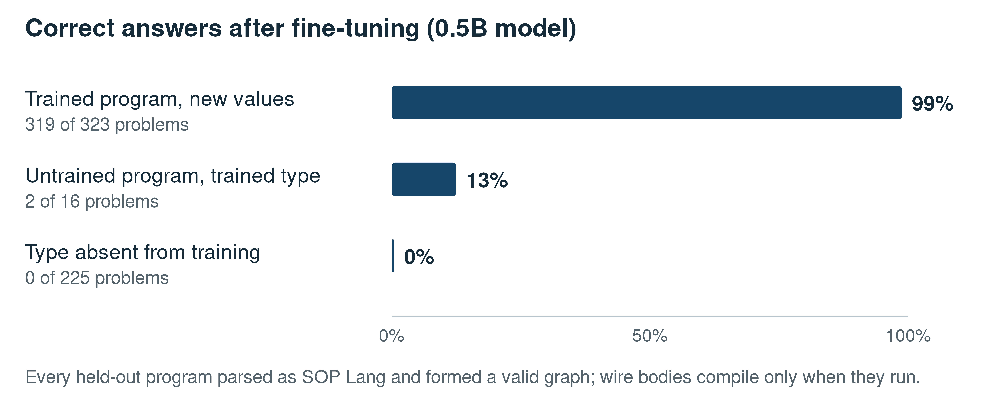
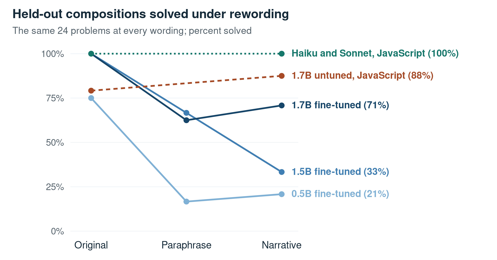

# Taught operations, taught wording: what small models transfer when fine-tuned to write programs

## Abstract

Small language models can be fine-tuned to translate word problems into programs that a runtime executes, and what they transfer to unseen problems decides what training data they need. We fine-tuned open models of 0.5 to 1.7 billion parameters to write programs in a dataflow language, and tested the results with evaluation-only experiments on identical problems. The fine-tuned models wrote well-formed programs and solved problems whose solution program they had been trained on, but almost none from untrained problem types; changes to the learning rate, the adapter, the data mixture, the target structure, and the prompt did not change that. A curriculum of declared operation combinations, with whole combinations held out, gave complete transfer to unseen combinations of taught operations in the training generator's wording. Rewording the same problems removed much of that transfer and degraded trained combinations as well, and a taught solution procedure that failed on book problems succeeded once the problems were restated in the teaching template. Prompted to write plain JavaScript, the untuned 1.5B and 1.7B models solved most unseen combinations, the 1.7B model equally in both wordings tested. Two larger prompted models solved nearly every problem in every wording, so the limits we found are not properties of the task. Held-out combinations rendered by the training generator overstate transfer: evaluations of fine-tuned program writers should reword them and report the untuned model writing code as the baseline to beat. Fine-tuned small program writers suit bounded problem classes whose operations and wordings their training data cover.

Keywords: small language models; program-aided reasoning; compositional generalization; robustness to rewording; synthetic training data; supervised fine-tuning

## 1. Introduction

A code model of half a billion parameters, fine-tuned on a few thousand synthetic programs in a language it had never seen, wrote a well-formed program for every one of 225 held-out problems. Where a problem's solution program had appeared in training, its programs returned the right answer almost always. Where the problem type was new, they returned it in none of the 225 cases. The model had learned the form of the language and no way to use it on something new. This paper asks what such a model does transfer, and what that implies for the data used to train it.

The question is practical. Program-aided reasoning lets a language model write code that an interpreter executes, which moves arithmetic out of the model's job (Gao et al., 2023; Chen et al., 2023). Small models are attractive for this role because they are cheap to run and can be specialized by fine-tuning on synthetic problems with program solutions (Magister et al., 2023; Fu et al., 2023; Liu et al., 2023). Whoever builds such a system must decide what training data to generate: more instances of the same problems, more kinds of problems, more varied presentation, or a larger model instead. That decision depends on what a small model transfers from program-writing data to problems it was not trained on. Studies of compositional generalization predict failures on new combinations of known parts (Lake & Baroni, 2018; Keysers et al., 2020), and studies of math word problems show that models are sensitive to how a problem is worded (Patel et al., 2021; Shi et al., 2023). Neither settles the question for a small model fine-tuned on synthetic programs, where the wording of the training data is known and can be varied on purpose.

We fine-tuned open models of 0.5 to 1.7 billion parameters to write programs in a small dataflow language and asked three questions:
- **RQ1.** What transfers from program-writing fine-tuning: the language, the trained programs, new combinations of trained operations, or new problem types?
- **RQ2.** Is transfer to new combinations a property of the taught operations or of the training generator's wording?
- **RQ3.** What does fine-tuning add over prompting the same models to write ordinary code, and are the limits we find properties of the task or of the small models?

A sequence of training runs answers RQ1. Evaluation-only experiments, in which no model was trained and the conditions of each comparison answered the same problems, answer RQ2 and RQ3.

The answers carry a lesson beyond our system. Held-out combinations rendered by the training generator overstated transfer: compositions that fine-tuned models solved without error in the generator's wording were solved far less often when reworded, and even trained compositions degraded. A taught solution procedure that failed on book problems in their own wording succeeded when the same problems were restated in the teaching template's words. And untuned models prompted to write plain JavaScript came close to the fine-tuned models within the curriculum; the untuned 1.7B model did not lose accuracy under rewording, and on one problem type outside the curriculum it far exceeded its fine-tuned versions. Evaluations of fine-tuned program writers should reword held-out items and report the untuned model writing code as the baseline to beat.

We make five contributions:
1. A coverage ladder, from trained programs through new programs of trained types to untrained types, with the failure mechanisms visible in the generated programs (RQ1, Section 4).
2. A sequence of interventions on the recipe, the data, and the prompt that left transfer to untrained types at or near zero (RQ1, Section 4).
3. A declared inventory of operation compositions with whole compositions held out, and a rewording test on the same problems that separates the taught operations from the training wording (RQ2, Section 5).
4. Book problems restated in the teaching template, which show a taught procedure succeeding in the taught wording and failing in the book's, and how much a single byte of the prompt could change (RQ2, Section 6).
5. Comparisons with the untuned models answering directly, writing plain JavaScript, or writing the same language from examples, and with two larger prompted models (RQ3, Section 7).

## 2. Related work

**Program-aided reasoning and small program writers.** In program-aided reasoning a language model writes a program and an interpreter executes it, so that the model is responsible for the plan and not for the arithmetic (Gao et al., 2023; Chen et al., 2023). Fine-tuning small models on reasoning produced by larger ones improves their task performance (Magister et al., 2023), and a small model's capacity can be concentrated on a target reasoning task at a cost to its general abilities (Fu et al., 2023). Several systems fine-tune models to write programs for mathematics: models of about a billion parameters on a large synthetic set of problems with executable Python solutions (Liu et al., 2023), and models of 7B parameters or more on trajectories that interleave reasoning with tool calls (Gou et al., 2024) or on mixtures of natural-language and program rationales (Yue et al., 2024; Wang et al., 2024). These works report accuracy on benchmark distributions. We ask what a small program writer transfers across problem types and wordings when the coverage of its training data is declared and can be varied.

**Compositional generalization.** Sequence-to-sequence networks can fail to generalize systematically to new combinations of known primitives (Lake & Baroni, 2018). Such failures track how compounds, rather than atoms, differ between training and test (Keysers et al., 2020); models near-perfect in distribution are far weaker on novel combinations (Kim & Linzen, 2020); and test instances that contain local structures unobserved in training are the hard ones (Bogin et al., 2022). Neural program synthesizers generalize poorly to compositions they were not trained on (Shi et al., 2022; Shi et al., 2024), and transformers can reduce multi-step reasoning to matching computation subgraphs seen in training (Dziri et al., 2023). Shaw and colleagues showed that synthetic compositional splits and natural language variation are distinct challenges, and that methods good at one can fail at the other (Shaw et al., 2021). Our rewording test measures both on the same problems and the same models.

**Robustness to wording.** Neural solvers of math word problems can rely on shallow heuristics and fail on simple variations (Patel et al., 2021); an irrelevant sentence in a problem lowers the accuracy of prompted large models (Shi et al., 2023); changing the numbers in a problem, or adding a clause that seems relevant but is not, lowers it further (Mirzadeh et al., 2025); and formatting changes that should not matter can change results substantially (Sclar et al., 2024). These studies examine prompted models on benchmark problems. Our setting adds what they lack: the wording of the fine-tuning data is known, so the distance of a test problem from it can be set on purpose.

**Fine-tuning and what it costs out of distribution.** In image classification, fine-tuning can distort pretrained features and underperform out of distribution (Kumar et al., 2022), and combining the weights of the fine-tuned and the original model recovers much of the lost robustness (Wortsman et al., 2022). Sequential training causes forgetting (Kirkpatrick et al., 2017); continual instruction tuning of models from 1B to 7B parameters erodes general knowledge and reasoning (Luo et al., 2025); low-rank adaptation learns less of a target domain and forgets less outside it than full fine-tuning (Biderman et al., 2024); and capabilities lost to narrow fine-tuning can be suppressed rather than erased (Kotha et al., 2024). Our comparison of fine-tuned models with the untuned models they started from shows one such loss, and how much of it the target language explains rather than fine-tuning.

## 3. Setting

### 3.1 The target language

The models write programs in SOP Lang, a small dataflow language developed for this project. A program is a set of named computations called wires. Each wire is declared on a line `@name command` followed by a body, and a body can read another wire's value as `$name`. Those references define a dependency graph that the runtime executes in order. Two commands matter here: `literal`, whose body is a JSON value, and `jsEval`, whose body is JavaScript executed in a sandbox. A compiled solution records the quantities extracted from the problem in a `slots` literal and computes the answer from them:

```sop
@slots literal
{"packs": 3, "perPack": 4}

@answer jsEval
return $slots.packs * $slots.perPack;
```

The runtime returns the value of `answer`, here 12. The model reads the problem, extracts the values, and chooses and writes the computation; the runtime executes it exactly. Longer solutions add intermediate wires, for example a filtered list that a later wire totals. A program parses when its wires and references are well formed; the JavaScript inside a wire is compiled only when the wire runs.

### 3.2 Problems, types, shapes, and programs

Training problems came from two sources. Seven books of reasoning exercises were transcribed into problem types. Each type generates statements from a printed template with a reference program and an independently computed answer. We call these book types. A procedural generator produced further types built from elementary operations on lists of numbers, such as filtering by a threshold, totalling, counting, taking the largest value, and adding a fixed amount. Every accepted example was executed, and its inputs were perturbed to confirm that the answer depended on them.

Three terms recur. A problem type's solution shape is the computation it requires, independent of wording, such as a chain of tasks with one parallel join. A program is one text that implements a shape. A fingerprint is a hash of a reference program's source text with the problem's specific values removed. It covers wire names, assertion messages, and the wording of the returned sentence, so a new fingerprint marks a new program text, which may or may not be a new computation. We use fingerprints to separate three kinds of held-out problem: a trained program with new values, a new program within a trained type, and a problem from a type absent from training. The first dataset held 6,775 examples over 893 fingerprints, distributed very unevenly: one book contributed 579 fingerprints over 990 examples, another nine fingerprints with 100 examples each.

### 3.3 Models and training runs

We fine-tuned the released checkpoints of Qwen2.5-Coder-0.5B-Instruct (Qwen, n.d.-a), Qwen2.5-Coder-1.5B-Instruct (Qwen, n.d.-b), and Qwen3-1.7B (Qwen, n.d.-c); the last is a general-purpose model rather than a code model. These checkpoints are already instruction-tuned. We call them untuned when they are used without our fine-tuning, and Qwen3's thinking mode was disabled whenever we prompted it. Training was full fine-tuning with AdamW at learning rate 10⁻⁴, effective batch size 32, sequence length 4,096, and a fixed seed; the first series also tried a lower learning rate and a low-rank adapter (rank 16, α 32, at the same learning rate). Early runs trained for three epochs and later runs for two. Each run was trained once.

Table 1 lists the runs the paper refers to, by the label used in the text. Each data version kept what came before it unless the table says otherwise.

Table 1. Training runs referred to in the text, in order.

| Label in the text | Model | What the training data added | Used in |
| --- | --- | --- | --- |
| First series | 0.5B | Book types only; three runs: learning rate 2×10⁻⁵, learning rate 10⁻⁴, and a low-rank adapter | Tables 2, 3 |
| Intervention runs | 0.5B | In turn: ten procedural types, multi-stage targets, twenty program shapes, a 10% mixture of general code, contrastive pairs | Table 3 |
| First inventory | 0.5B | Declared compositions of ten operations, four held out; validation boilerplate moved into the runtime | Table 4 |
| Extended inventory | 0.5B, 1.5B | Compositions with new operations (remainders, percentages, ranks, ratios), eight held out | Tables 4, 5; Fig. 2 |
| Declarative commands | 1.5B, 1.7B | Compositions with time, reachability, and area operations, eleven held out in all; commands that own whole algorithms | Tables 6, 7 |
| Compact targets | 1.7B | Further scheduling problems; procedural types teaching four book shapes, two of them held-out book types (scheduling with a join, minimal winning coalitions); fewer assertions; container commands | Tables 5 to 8; Fig. 2 |
| Three later runs | 1.7B | Changes to the programs and reference answers of the two books no run had solved (Section 6.1) | Section 6.1 |
| Simplified statements | 1.7B | Simplified statements for those two books | Section 6 |
| Final data | 0.5B, 1.7B | A fractional rate type taught; whole-number checks relaxed | Sections 6, 7 |

### 3.4 Evaluation

The held-out set began as 225 problems from book types absent from training. These carry 16 fingerprints, and one scheduling type contributes 100 of the 225, so a result over the 225 is closer to a result over 16 programs than over 225 independent problems. The set later gained a withheld procedural type of 40 problems and the held-out compositions, 40 problems each. For each problem the selected checkpoint generated one program greedily; the runtime executed it; and the outcome was classified as a parse failure, an invalid graph, an execution error, an executed answer that did not match the reference string, or a match. Checkpoints were selected on a validation slice of 339 examples: 323 with a trained fingerprint and 16 with a fingerprint that occurred nowhere else. Sixteen is small: a proportion over 16 items carries a 95% confidence interval of about ±25 percentage points, so we read that column only as a range. We re-executed every saved program of the held-out evaluations of trained checkpoints (13,330 records in 26 runs) through the evaluation code, and every recorded outcome and answer was reproduced.

The held-out items were not frozen. For the two books whose problems no run had solved, one data version shortened the reference answers to their values (for example, "46 minutes: not feasible.") and the next simplified the statements, removing a scenario sentence, a distractor sentence, and a decomposition hint. Each run was scored on the items current at its evaluation; the evaluation-only comparisons use the final items for every condition. The set was also inspected repeatedly to guide decisions, so it is a development benchmark rather than a clean test (Dwork et al., 2015).

Matching compared normalized answer strings, which can reject a correct answer phrased differently. For the early runs this explains almost none of the failures. Among the book-type answers that executed but did not match, no more than 6 in any early run even contained every number of the reference; the rest either failed to execute or returned different values. Where later runs are affected, we say so and report a retrospective parser alongside the exact count.

**Evaluation-only comparisons.** Sections 5 to 7 add comparisons that required no training. Within each comparison, every condition answered the same problems:
- 115 of the held-out problems, at most five per problem family, chosen by a seeded hash: 55 from the 11 held-out compositions, 55 from the book types, and 5 from the withheld procedural type. On the book side the coalition problems form four families, one per difficulty grade, and contribute 20; five other families contribute 5 each, and ten small families one each;
- 45 problems per wording for the rewording tests, three instances of each of the 11 held-out and 4 trained compositions, the same instances at every wording;
- 30 book problems per wording for the shape tests, 15 scheduling and 15 coalition problems;
- all 40 problems of the withheld procedural type.

The untuned models were evaluated in three ways: answering directly; writing the body of one plain JavaScript function, with one solved example of a trained type; or writing SOP Lang taught in the prompt by a syntax guide and three solved examples of trained types. Their JavaScript ran in the same sandbox as the fine-tuned models' programs. Two larger models answered the same problems; Section 7.2 describes how.

**Scoring.** These comparisons are scored at three levels: exact matching; a strict value check on the numbers and any verdict; and a semantic level, at which an answer counts if it matches exactly or if two blind judges both accept it. The judges were separate sessions of Claude Opus 5.5 that saw only the statement, the reference, and the candidate, with the producing model and condition hidden. They agreed on 98.3% of 2,048 distinct answers (Cohen's κ = 0.97), accepted none of 25 injected wrong answers, and accepted all 50 answers that a deterministic parser proves equivalent to the reference. Every verdict is retained. The judges were lenient in one known way: both accepted answers to elapsed-time problems that omitted the unit the reference states. We report the semantic level unless stated otherwise.

**Sample sizes and resolution.** These sizes were set by a budget and by the kind of answer we needed. All models and conditions had to run within about one night of GPU time shared with other work, and the questions were qualitative: does a condition solve a kind of problem never, sometimes, or almost always, and does rewording remove that ability? Five problems per family, or three instances per composition, give every family and composition the same weight and suffice for such contrasts. The withheld type was evaluated in full because its five-problem sample showed a surprising contrast (Section 7.3). We report results as percentages of the stated number of problems. At 55 problems a proportion carries a 95% confidence interval of at most about ±13 percentage points, at 33 about ±17, and at 15 about ±25. Problems from the same composition or family share a solution program, so the effective resolution is coarser. We therefore read as findings only differences of roughly 20 points or more, or contrasts between floor and ceiling, and we call smaller differences undetectable at these sizes. Within each comparison every condition answered the same problems, so no difference between conditions comes from different samples.

## 4. What transfers: the coverage ladder

### 4.1 A complete form and no procedure

Table 2 shows the first result, which set the question for everything that followed.

Table 2. The coverage ladder in the first series (0.5B model), in percent. Validation: 323 examples with trained programs and 16 with untrained programs (selected checkpoint). Held-out: 225 problems from book types absent from training (265 for the low-rank run).

| Run | Trained programs correct | Untrained programs correct | Held-out types correct | Held-out programs that executed |
| --- | --- | --- | --- | --- |
| Full fine-tuning, learning rate 2×10⁻⁵ | 56% | 6% | 0% | 12% |
| Full fine-tuning, learning rate 10⁻⁴ | 99% | 13% | 0% | 28% |
| Low-rank adaptation (rank 16) | 54% | 19% | 0% | 12% |

The untuned model, prompted without a syntax guide or examples, produced no parseable program for any of 50 sampled problems. After fine-tuning at the higher learning rate, every held-out program parsed and formed a valid graph. Problems with trained programs were solved almost always, new programs of trained types rarely, and untrained types never. The lower learning rate left the model far from convergence on its own training data and produced the same zero, as did the adapter. The failure was therefore not an artefact of these recipe settings.



**Fig. 1** The coverage ladder of the best first-series run. Validation problems with trained programs (323) and untrained programs (16), and held-out problems from untrained types (225, from 16 programs). Every held-out program parsed and formed a valid dependency graph; the JavaScript inside a wire is compiled only when the wire runs

### 4.2 How the programs failed

The failing programs show what the model did instead. Consider a held-out scheduling problem as the model saw it:

> Scenario. In household faults and maintenance observations, five work packages A–E must be completed. A takes 7 minutes. B (11 min) and C (17 min) can start only after A but may then run in parallel. D (6 min) needs both B and C finished. E (12 min) follows D. A final safety or review buffer of 4 minutes is mandatory, and the completion limit is 43 minutes. The description mentions the total number of observations, but the task durations already incorporate that workload, so recounting them would double-count input.
>
> Main question. What is the earliest safe completion time, and does the plan meet the limit? Best decomposition (5 subproblems).

The correct program is a chain with one join: 7 + max(11, 17) + 6 + 12 + 4 = 46 minutes, which exceeds the limit. The model's program extracted the durations correctly but declared A and C, rather than B and C, as the parallel pair. It opened with a validation line assembled from two different training programs: one checked a map of durations with `every`, the other checked a single number with `Number.isInteger`. The combination left a parenthesis unclosed, so the program's JavaScript did not compile. Its return sentence ended "because the total number of observations is 5". The model had reacted to the distractor sentence the statement told it to ignore.

Across the 225 held-out problems, the failures fall into three groups:
- 80 programs (36%) failed when their JavaScript was compiled. In 58 of them, the spliced validation line was the cause.
- 77 (34%) compiled but were stopped by an assertion the model had written itself. Examples are "at least one group must reach the winning threshold" and "every work package must have a single duration". These are constraints the problem did not state or that the extracted values violated.
- 62 (28%) ran to completion and returned wrong answers. Of these, 50 came from one rate type. Those programs computed the right kind of quantity, useful output over a period, but got the units wrong: 48 of the 50 multiplied the throughput by the percentage and by the running time in minutes, without dividing the percentage by 100 or converting minutes to hours. Some printed a template with unfilled fields, such as "The useful output is 125400 undefined in undefined minutes."

The remaining six hit other runtime errors. The pattern resembles what Dziri and colleagues describe as matching stored computation subgraphs (Dziri et al., 2023). The model assembled programs from remembered fragments, including their assertions and their sentences, rather than deriving the computation the statement required.

### 4.3 Interventions that did not move transfer to untrained types

The natural response to Table 2 was to change the training. The programme tried the interventions in Table 3 in sequence, each suggested by the previous result. The data-side changes were cumulative, each building on the previous dataset, so the rows are a sequence rather than independent ablations.

Table 3. Interventions against the held-out result (0.5B model), in percent. Untrained programs: best over all scored checkpoints of the run, of 16 validation examples. Held-out: 265 problems, the 225 book-type problems plus 40 from a withheld procedural type; the first row used the 225 only. A single held-out problem is 0.4%.

| Intervention | Hypothesis | Untrained programs | Held-out correct | Held-out executed |
| --- | --- | --- | --- | --- |
| Lower learning rate | Less memorization, more generalization | up to 13% | 0% | 12% |
| Low-rank adaptation | Preserving the base model preserves general skill | up to 19% | 0% | 12% |
| Wider curriculum (ten procedural types added) | More kinds of program | up to 19% | 0.4% | 18% |
| Multi-stage targets (intermediate wires) | Showing intermediate structure teaches decomposition | up to 19% | 0.4% | 13% |
| Twenty program shapes with two published stages | Deeper taught structure | up to 25% | 0.4% | 31% |
| Capability-preservation mixture (10%) | Restoring general code skill helps new programs | up to 25% | 0% | 19% |
| Contrastive minimal pairs | Forcing attention to the decisive word | up to 19% | 0.4% | 21% |
| One or three solved examples in the prompt | Demonstrations enable adaptation | — | 0% | 10% (three examples) |

For comparison, the full-fine-tuning run of Table 2 reached up to 19% (3 of 16) untrained programs across its checkpoints. None of these eight interventions moved held-out correctness off the floor. The single correct answer in three of these runs was the same problem, a comparison of two groups by percentage that resembles a trained type; one other run solved a different single problem. The executing fraction varied between 10% and 31% without changing correctness: the additional programs that ran returned wrong answers. The untrained-program column stayed between 6% and 25% (1 to 4 of 16) across 72 scored checkpoints, a range that 16 examples cannot distinguish from no change.

Low-rank adaptation (Hu et al., 2022) merits a note because it bears on a published comparison. Biderman and colleagues found that it learns less of a target domain than full fine-tuning and forgets less outside it (Biderman et al., 2024). Here it did learn less: 54% on trained programs, against 99% for full fine-tuning at the same budget. An adapter is usually trained at a higher learning rate than full fine-tuning, so this run may understate what an adapter can do. Its score on ten short instruction and JavaScript probes, 0 of 10 against 1 of 10 for full fine-tuning and 4 of 10 untuned, is too small a sample to test the forgetting claim.

Two interventions are worth describing because they show how the failure behaves.

**Contrastive minimal pairs.** Six procedural types rendered the same statement twice, differing only in a decisive phrase that changed the required operation. We scored the resulting model on 24 new pairs, 8 of each kind; eight pairs are few, but the contrast between the kinds was close to all or nothing:
- **Boundary word** ("above" against "at least"): both members answered correctly in 7 of 8 pairs.
- **Largest against smallest record:** both answered correctly in none of 8. In four of these pairs one member's program crashed, and in the rest the two members returned different wrong values.
- **Fixed amount against percentage:** both answered correctly in 1 of 8.

The distinction the model learned was local and lexical: a word that flips a comparison inside an otherwise identical program. It did not learn the distinctions that require a different operand or operation. A raw count of operator occurrences in the training programs does not favour threshold comparisons, so frequency is an unlikely explanation.

**Demonstrations.** Placing one or three solved problems from other types in the prompt did not produce a single correct held-out answer. It moved failures from wrong answers to crashes: execution errors rose from 63% to 90% of the 265 problems.

We also tried retries, on a later model (the extended-inventory 0.5B model of Section 5) and on 30 development problems within its inventory. Retries can only address crashes, and only two of the 30 programs crashed. Retrying with the full error history, up to twice, made both run; both then returned wrong answers, and the same 17 of the 30 problems (57%) were solved with and without retries. We did not test retries on untrained types. Olausson and colleagues found self-repair in code generation limited by the model's ability to diagnose its error (Olausson et al., 2024); our small model could repair a crash into a running program, but not into one that answered the question.

## 5. Operations or wording?

### 5.1 A curriculum of declared compositions

The procedural types until then had been designed one at a time, each a small scenario with its own program. The next curriculum was designed differently. It declared ten elementary operations and defined types as compositions of them, for example "keep the values below a threshold, take the largest, add a fixed amount". Twenty-two compositions were declared. Eighteen were rendered into training examples, 40 instances each; four were held out whole before any example was generated, so that no training example contained them in any form. In the same data version, the validation boilerplate that every target program had carried moved into the runtime, so that target programs contained only the computation and its answer assertions.

A second tranche added operations identified by counting what the book types' reference programs actually do: remainders, percentages and discounts, ranked positions such as the third-largest value, and ratios. It declared 37 compositions and held out eight: the four original ones and four that each used at least one new operation. The same count listed operations the books needed that the inventory still lacked, including time arithmetic, graph traversal, set operations, geometry, and probability. A third tranche introduced three of them (elapsed time, reachability in a graph, and rectangle area) and held out three more compositions, for eleven in all; every run from the declarative-command data onward was trained with it.

### 5.2 Transfer within the inventory

Table 4 shows the held-out results of the inventory runs.

Table 4. Held-out results under the composition curriculum, percent correct. Each held-out composition has 40 problems, so each row of four compositions has 160; no training example contains any of them. Held-out compositions have depths of three or four operations. At 40 instances per composition, 0% and 100% are unambiguous, and an intermediate result marks partial, unreliable transfer.

| Held-out slice | 0.5B, first inventory | 0.5B, extended inventory | 1.5B, extended inventory |
| --- | --- | --- | --- |
| Unseen compositions of the original operations (4 compositions) | 100% | 100% | 100% |
| Unseen compositions including a newly added operation (4) | — | 60% | 100% |
| Withheld procedural type outside the inventory (40 problems) | 0% | 0% | 0% |
| Book types outside the inventory (225 problems, 16 programs) | 0.4% | 0.9% | 0.9% |

The first row is the programme's first transfer result above floor level. The model solved every instance of four compositions it had never seen in any form. There is a partial "before" for comparison. A diagnostic suite of similar filter-and-aggregate chains, scored on the preservation-mixture model before the inventory existed, gave 13% correct (8 of 60). That model scored 0 of 10 on each of four chain structures, including taking the largest kept value and adding a fixed amount, a chain that the inventory later held out. The diagnostic suite used a different generator, and the inventory's data version also removed the validation boilerplate whose spliced lines caused most compile failures in Section 4.2, so this contrast confounds the inventory with the boilerplate change. The boilerplate change alone did not produce transfer outside the inventory: the withheld type and the book types stayed at or near zero after it.

### 5.3 Rewording separates the operations from the wording

Two readings of the first row must be distinguished. On the vocabulary reading, the model transferred because the held-out compositions used only operations it had been taught as composable units. On the template reading, it transferred because the held-out compositions were rendered by the same generator as the trained ones, with the same statement template, input names, stage structure, and answer sentence. The withheld procedural type and the book types differ from the trained compositions both in their operations and in their surface, so they cannot separate the two readings.

We separated them by rewording. The same held-out compositions, and trained compositions as controls, were rendered at three distances from the generator, with the numbers, operations, and reference answers unchanged:
- **Original:** the generator's own statement.
- **Paraphrase:** the same content and order in different words, for example "Discard every entry of 25 or less" for "keep only the records above 25".
- **Narrative:** the style of the book problems, with a scenario, the operations described in prose, one irrelevant number, and the question last.

Table 5 shows the result for three models, each scored on the same problems at every wording: three instances per composition, chosen among instances already evaluated so that the paired design fitted the budget; the choice depended only on which instances earlier samples had drawn, never on their outcomes. Instances of one composition share its program, so the composition, not the instance, is the unit here. The two inventory-era runs were trained before the time, reachability, and area operations existed, so their rows use only the eight held-out compositions and three controls within their own inventory.

Table 5. Rewording test, percent correct at the semantic level (exact matches in parentheses). The same instances at every wording, with numbers and references unchanged: 24 held-out and 9 trained-control problems for the two inventory-era runs, 33 and 12 for the 1.7B run. On the 24 and 9 problems that all three runs share, the 1.7B run solved 100%, 63% and 71% of the held-out problems and 100%, 67% and 89% of the controls.

| Model | Wording | Held-out compositions | Trained controls |
| --- | --- | --- | --- |
| 0.5B, extended inventory | Original | 75% (75%) | 100% (100%) |
| 0.5B, extended inventory | Paraphrase | 17% (17%) | 56% (56%) |
| 0.5B, extended inventory | Narrative | 21% (13%) | 67% (56%) |
| 1.5B, extended inventory | Original | 100% (100%) | 100% (100%) |
| 1.5B, extended inventory | Paraphrase | 67% (17%) | 78% (22%) |
| 1.5B, extended inventory | Narrative | 33% (17%) | 22% (0%) |
| 1.7B, compact targets | Original | 100% (100%) | 100% (100%) |
| 1.7B, compact targets | Paraphrase | 55% (39%) | 75% (67%) |
| 1.7B, compact targets | Narrative | 73% (61%) | 92% (75%) |

Rewording hurt the held-out compositions at every size: from 75% to about a fifth at 0.5B, and from 100% to between a third and three quarters at 1.5B and 1.7B. It also hurt compositions the models had been trained on, so part of the transfer in Table 4 is bound to the generator's wording rather than to the operations. Whether rewording hurt new compositions more than trained ones can be read only at 0.5B, where a paraphrase left 17% of the held-out problems solved against 56% of the trained ones. At 1.5B and 1.7B the two differ by less than samples of this size can resolve, and at 1.5B the narrative wording left the trained controls no better off (22% against 33%). Under paraphrase, the 1.5B and 1.7B runs kept about two thirds of the shared held-out problems; only the 1.7B run kept most of them in narrative wording. That run differs from the other two in model family and training data as well as size, so we do not attribute its robustness to size alone.

Fig. 2 plots the held-out problems that the three runs share, with two references on the same problems: the untuned 1.7B model writing plain JavaScript, and the two larger models of Section 7.2. Neither reference lost accuracy under narrative wording.



**Fig. 2** Held-out compositions solved under rewording, on the 24 problems (eight compositions, three instances each) that the three fine-tuned runs share, semantic level. The untuned 1.7B model and the two larger models were evaluated in the original and narrative wordings only

Both readings therefore hold in part. New compositions of taught operations transfer reliably only in familiar wording, and even familiar compositions degrade when the wording changes. The book types are worded like the narrative condition, which even trained compositions did not reliably survive at the two smaller sizes.

### 5.4 First exposure, the edge of the inventory, and scale

The second row of Table 4 shows first exposure to a new operation. Of the four compositions that included one, the 0.5B model solved two completely (remainders and ratios) and two poorly: 18% and 23% of their 40 problems, for a percentage discount and for a percentage of the third-largest value. The failures were uniform: the model used the new operation as a variant of its neighbour. In the third-largest composition, the programs indexed the sorted list with the percentage instead of the rank, which they never extracted. In the discount composition, they subtracted the discount multiplied by 100, a fragment of the percentage operation applied in the wrong place. In all 64 failures the program's final assertion, that the answer must be a non-negative whole number, caught the wrong value.

The 1.5B model trained on the same data solved all eight held-out compositions. This first-exposure success did not replicate across data versions. A 1.5B model trained on the next data version, with the same base, solved 43% and none of the same two compositions and failed the same way; a 0.5B model on that version solved neither. A later 1.5B run solved both. First-exposure transfer to a new operation was therefore partial and unstable, and it varied with the data version as much as with model size.

The third and fourth rows show that transfer outside the inventory stayed near zero. The withheld procedural type asked whether stock would last until a delivery. It required rounding days down before comparing them with a lead time. The models computed a fractional number of days and then reversed the verdict, answering "The stock covers 18.642857142857142 whole days and must be placed today" where the reference reads "The stock covers 18 whole days, so the order can wait." The validation column of untrained programs did not move either: it stayed at 19% or 25% (3 or 4 of 16) in the three inventory runs.

Scale moved results within the inventory, not outside it. The same extended curriculum trained the 0.5B and the 1.5B model of the same family with the same recipe. The larger model was more accurate on the 360 held-out procedural problems (89% against 71%) and solved the first-exposure compositions the smaller model had failed, a result that did not hold in the next data version. Outside the inventory it was no better. It solved 2 of the 225 book problems, the same number as the smaller model, one of them the same problem, and none of the withheld type. More of its book-type programs ran (execution errors fell from 87% to 68% of the 225), but the additional programs that ran returned wrong answers.

## 6. Taught shapes and book wording

### 6.1 Two shapes across the 1.7B series

Later runs on Qwen3-1.7B extended the curriculum with procedural types modelled on specific book shapes, rendered with different wording and numbers (Table 1, compact targets onward). Two of these shapes correspond to held-out book types.

**Minimal winning coalitions.** Given parties and seat counts, list the smallest groups that reach a majority. The book held-out set contained 20 problems of this shape. Every run before the procedural type entered training solved none of them, mostly with programs that failed to execute. In the first 1.7B run that included it, all 20 were solved. Every later 1.7B run solved at least 80% of them. In one of those runs the model separated coalitions with commas where the reference used semicolons, and a comparison of coalition sets rather than strings was needed to see this. The 0.5B model trained on the same final data solved none; all of its programs failed to compile.

**Scheduling with a join.** For the 100 held-out problems of the type in Section 4.2, exact matching accepted none in any run. A retrospective parser checked the stated duration and verdict. We wrote it after seeing the outputs, and it accepts the long reference sentence and the later shortened form. The statements and references changed during the series: the first three runs trained with the shape were scored with the long references and the original statements, the fourth with the shortened references, and the last two with the shortened references and the simplified statements. The parser accepted 64%, 0%, 0%, 2%, 54% and 0% of the 100 problems in these six runs, and 3% for the 0.5B run on the final data. Many of the remaining outputs failed to execute, though not in every run. The parser is strict: in the third run, 18% of the outputs state the correct duration and verdict in a wording it does not accept ("does not meet the completion limit"), and 20% more give the correct number in the wrong unit ("work packages"). With a looser grammar, three of the six runs show transfer.

### 6.2 The same problems in the teaching template

Whether these failures reflect the plan or the wording can be tested directly. We restated 15 held-out scheduling problems and 15 coalition problems in the sentence template of the procedural types that teach those shapes, keeping their numbers and reference answers. The rewrite was mechanical: each book statement was parsed and its values rendered by the teaching type's own generator, and the build refused any item whose numbers or reference answer changed. For the scheduling problems the two wordings differ in three phrases (Box 1); the durations, the clause order, and the reference answer are identical. The coalition rewording is larger: it removes the headed sections of the book statement and states the same facts in a few plain sentences. The book wording is the final, simplified statement. Fifteen problems of each type suffice for the contrast this test is built to detect, whether a run solves the rewritten problems at all, which at this size separates none from all without ambiguity.

> **Box 1. One scheduling problem in the book's final wording and in the teaching template (differences in italics).**
>
> **Book.** *Five work packages A–E must be completed.* A takes 5 minutes. B (6 min) and C (5 min) can start only after A but may then run in parallel. D (9 min) needs both B and C finished. E (7 min) follows D. A final *safety or review buffer* of 5 minutes is mandatory, and the completion limit is 44 minutes. *Question.* What is the earliest safe completion time, and *does the plan meet the limit?*
>
> **Template.** *A project runs five work packages in a chain.* A takes 5 minutes. B (6 min) and C (5 min) can start only after A but may then run in parallel. D (9 min) needs both B and C finished. E (7 min) follows D. A final *safety buffer* of 5 minutes is mandatory, and the completion limit is 44 minutes. What is the earliest safe completion time, and *is the plan feasible?*

Table 6 gives the result.

Table 6. Book problems in their final book wording and in the teaching template, percent correct at the semantic level (15 problems per cell). The first run, on the declarative-command data, was never taught either shape.

| 1.7B run | Scheduling, book wording | Scheduling, template wording | Coalitions, book wording | Coalitions, template wording |
| --- | --- | --- | --- | --- |
| Declarative commands (shapes never taught) | 0% | 0% | 0% | 0% |
| Compact targets | 100% | 100% | 100% | 100% |
| Simplified statements | 53% | 100% | 100% | 100% |
| Final data | 0% | 100% | 100% | 100% |

Every run taught the shapes solved every problem restated in the teaching template, including the final-data run, which solved none of the same scheduling problems in their book wording. The run never taught the shapes solved none in either wording. The scheduling procedure had been learned; what failed, partly in one later run and fully in another, was recognizing it under the book's wording. For the final-data run, the three phrases of Box 1 decided whether its scheduling programs ran at all: 1 of 15 ran in the book wording, and 15 of 15 in the template wording.

Single greedy decodes were also sensitive to the exact bytes of the prompt. Our first version of this test stored each statement without its final newline, which the held-out evaluation sends. For the simplified-statement run, that one byte changed 8 of its 15 coalition programs and lowered its book-wording coalition result from 100% to 47%. With the newline restored, the four runs reproduced the coalition programs of their original evaluations in 58 of 60 cases, against 38 of 60 without it; Table 6 uses the restored bytes in both wordings. The sensitivity supports this section's argument: a fine-tuned small model's success on a taught shape depended on reproducing the surface of its training data, down to its layout (Sclar et al., 2024).

Teaching the solution shape through independently generated problems was therefore necessary in these data: no run solved either type before its shape was taught. Once taught, the coalition shape transferred to the book wording in every 1.7B run, while the scheduling shape transferred fully in one run and partly in another, although all three solved it in the template wording. At 0.5B neither shape transferred (Section 6.1).

## 7. Baselines and ceilings

### 7.1 What fine-tuning adds over writing plain code

A reviewer will ask whether any of this requires fine-tuning. A code model can already write a program that computes an answer and let an interpreter run it (Gao et al., 2023; Chen et al., 2023). Table 7 compares the untuned models in three prompted conditions with fine-tuned runs on the same 115 held-out problems.

Table 7. Percent correct on the same held-out problems (semantic level): 55 problems from the 11 held-out compositions and 55 from the book types. JavaScript: one solved example of a trained type. SOP Lang in the prompt: a syntax guide and three solved examples of trained types. Fine-tuned: the latest run of each size, except at 1.7B, where both the run with the best held-out result (compact targets) and the latest run (final data) are shown; the 1.5B run was never taught the book shapes.

| Model | Condition | Held-out compositions | Book types |
| --- | --- | --- | --- |
| 0.5B | Untuned, direct answer | 16% | 9% |
| 0.5B | Untuned, plain JavaScript | 60% | 2% |
| 0.5B | Untuned, SOP Lang in prompt | 7% | 4% |
| 0.5B | Fine-tuned, final data | 82% | 7% |
| 1.5B | Untuned, direct answer | 4% | 24% |
| 1.5B | Untuned, plain JavaScript | 89% | 18% |
| 1.5B | Untuned, SOP Lang in prompt | 35% | 16% |
| 1.5B | Fine-tuned, declarative commands | 100% | 11% |
| 1.7B | Untuned, direct answer | 31% | 20% |
| 1.7B | Untuned, plain JavaScript | 82% | 18% |
| 1.7B | Untuned, SOP Lang in prompt | 62% | 2% |
| 1.7B | Fine-tuned, compact targets | 100% | 58% |
| 1.7B | Fine-tuned, final data | 93% | 49% |

Three observations follow.
- **Most of the gain on the held-out compositions comes from executing code, not from fine-tuning.** Answering directly, the untuned models solved between 4% and 31% of them. Writing plain JavaScript with a single example, the 1.5B and 1.7B models solved 89% and 82%. Fine-tuning brought both to 100% in its best runs, gains of 11 and 18 points at the limit of what 55 problems resolve, and raised the 0.5B model from 60% to 82%.
- **SOP Lang taught only in the prompt was worse than plain JavaScript on the compositions at every size,** by 20 to 54 points. Many of these programs failed before execution: 22%, 36% and 20% of the 115 at 0.5B, 1.5B and 1.7B did not parse or had an invalid dependency graph. Writing a language known only from a guide and three examples cost these models more than the language's structure gained them. The two prompts were not symmetric: JavaScript had one example, SOP Lang a guide and three.
- **The book types separate the conditions only where the curriculum taught the shape.** No untuned model solved more than 24% of the 55 book problems in any condition. The fine-tuned 1.7B compact-target model solved 58%, but 25 of its 32 correct answers were the two taught shapes: all 20 coalition problems and all 5 scheduling problems. On the other 30 book problems it solved 23%, against 27% for its untuned model writing JavaScript, 30% answering directly, and 40% for the untuned 1.5B model answering directly. Coalition problems are 20 of the 55 in the sample because they form four families. The 0.5B final-data run was taught both shapes but solved no coalition problem.

What fine-tuning adds, then, is not the ability to compose operations, which a code model with one example largely has at 1.5B and 1.7B. It adds reliable execution of the taught shapes, including shapes that plain code-writing does not reach.

### 7.2 Two larger models on the same problems

To locate the limits we found, two larger models answered the same problems with the same instructions and examples as the untuned small models, without fine-tuning: Claude Haiku 4.5 and Claude Sonnet 5. Their programs ran in the same sandbox and were scored with the same comparators and judges.

These models were evaluated through agent sessions rather than independent API calls. Each session received one batch of 60 to 115 problems in a single context and was instructed to answer each item independently, as if in a fresh conversation, without executing code or writing scripts. Orchestration records retain each session's model identifier, instructions, and number of tool calls, but not its full transcript. Batches of a first design that mixed two wordings of the same problem, and one batch whose replies were assembled by a script, were discarded and re-run so that no session saw two wordings of a problem. Four of the accepted batches still paired two answer forms of the same problems (operator plan with JavaScript, or JavaScript with SOP Lang), so those forms are not independent answers: on the book problems of Section 6.2, each model's JavaScript and SOP Lang answers were identical in all 30 cases. The larger models almost never matched the reference wording exactly (0 or 1 of the 55 book problems in every condition), so their scores rest on the judges, who were sessions of the same model family; language-model evaluators have been shown to favour their own summaries (Panickssery et al., 2024), and a similar preference here would inflate the larger models' scores. The larger models' answers were judged in a third pass that contained no calibration items, where the two judges agreed on 99.5% of 619 answers.

Table 8. Larger models and small models on the same problems, percent correct at the semantic level. Compositions and book types: the 55 and 55 problems of Table 7. Withheld type: all 40 problems. Rewording: the 33 held-out-composition problems of Table 5, in the original and narrative wordings.

| Model | Condition | Compositions | Book types | Withheld type | Rewording, original / narrative |
| --- | --- | --- | --- | --- | --- |
| 1.7B untuned | Plain JavaScript | 82% | 18% | 60% | 79% / 79% |
| 1.7B fine-tuned (compact targets) | SOP Lang | 100% | 58% | 5% | 100% / 73% |
| Haiku 4.5, untuned | Direct answer | 87% | 75% | — | — |
| Haiku 4.5, untuned | Plain JavaScript | 100% | 95% | 100% | 100% / 100% |
| Haiku 4.5, untuned | SOP Lang in prompt | 100% | 85% | 100% | 94% / 100% |
| Sonnet 5, untuned | Direct answer | 100% | 96% | — | — |
| Sonnet 5, untuned | Plain JavaScript | 100% | 98% | 100% | 100% / 100% |
| Sonnet 5, untuned | SOP Lang in prompt | 100% | 96% | 100% | 100% / 100% |

The larger models solved nearly every problem in every condition:
- They were unaffected by rewording.
- They solved all 15 book scheduling problems in the book's own wording, which the final-data fine-tuned model never solved.
- They solved all 40 problems of the withheld type.

The wording binding and the coverage boundary are therefore not properties of the task or of the program-writing formulation. They are properties of the small models as we trained and prompted them, and this comparison cannot say which difference between the model pairs removes them: the larger models differ in size, pretraining, and post-training, and they were not fine-tuned. The untuned 1.7B model was itself unaffected by narrative wording when it wrote JavaScript (79% in both wordings), but not when it wrote SOP Lang from the prompt (70% to 18%) or after fine-tuning (100% to 73%).

Writing code helped Haiku, the lower-cost of the two larger models, on the book problems: it rose from 75% answering directly to 95% writing JavaScript, and from 87% to 100% on the compositions. Sonnet answered directly almost as well as with code (100% and 96%). Neither larger model was more accurate with SOP Lang than with plain JavaScript; Haiku's lower score with SOP Lang on the book problems (85% against 95%) is within what 55 problems can resolve. The comparison also bounds what fine-tuning bought: the best fine-tuned 1.7B model matched the larger models on the compositions its curriculum covered and fell far short everywhere else. We cannot exclude that the larger models saw material similar to these problems during pretraining.

### 7.3 A problem type the untuned model solved

The withheld procedural type asks whether stock covers the days until a delivery. In their original evaluations the fine-tuned models solved almost none of its 40 problems (one problem, in one 0.5B run). We evaluated the type in full because the five-problem sample had shown a surprising contrast. Scored semantically, the two fine-tuned 1.7B runs solved 5% and none. The untuned Qwen3-1.7B model, writing plain JavaScript with one example of an unrelated trained type, solved 60%. For example, it returned "The stock covers 13 whole days. The order must be placed today: No." where the reference reads "The stock covers 13 whole days, so the order can wait." The untuned 1.5B code model solved only 5%.

Two differences separate the fine-tuned 1.7B system from its untuned model writing JavaScript: fine-tuning and the target language. To separate them, we evaluated the same untuned model writing SOP Lang, taught in the prompt, on all 40 problems. It solved none. Half of its programs (21 of 40) never reached execution, 20 of them because they did not define the output wire the runtime asks for; the other 19 ran or crashed and gave wrong answers. The fine-tuned models' programs, by contrast, ran and computed fractional days or reversed the verdict. Writing SOP Lang failed on this type whether the language was taught in the prompt or by fine-tuning, and writing JavaScript succeeded, so the loss cannot be attributed to fine-tuning alone. What the comparison shows is that the fine-tuned system, as built, could not do what its starting model could do by writing ordinary code.

Under narrative wording, the same untuned model writing JavaScript also matched the fine-tuned 1.7B model on held-out compositions (79% against 73% of the same 33 problems, a difference too small to read; Table 8).

Two further measurements bear on what fine-tuning cost and bought. Ten short capability probes were too few to measure forgetting: the untuned 0.5B model passed 4 of 10 and its fine-tuned versions 0 to 2. On 49 text-reasoning probes, the fine-tuned 0.5B wider-curriculum model answered none correctly when asked to answer directly, and its untuned model 10%. When it compiled each probe into a program, it solved 61%: all 16 letter-counting and all 9 word-counting probes, whose programs the curriculum taught, 4 of 8 string transformations, 1 of 10 trick questions, and none of 6 orderings.

## 8. Discussion

### 8.1 Answers to the three questions

**RQ1.** A small model fine-tuned to write programs learned three things with very different reach. It learned the form of the language at once. It learned the programs it was shown, recalling them for new values, and it recombined taught operations into unseen compositions when they were worded like its training data. It did not produce working programs for problem types whose solution shape the curriculum lacked, and changes to the learning rate, the adapter, the data mixture, the target structure, the prompt, and model size within the tested range did not change that.

**RQ2.** Both the operations and the wording mattered. Compositions whose operations were untaught, or new and confusable with a neighbour, failed in any wording. Compositions of taught operations transferred completely in the training generator's wording and partly when reworded, and trained compositions degraded too. A taught solution procedure that failed on book problems succeeded when the same problems were restated in the teaching template, and one byte of layout changed about half of one run's programs.

**RQ3.** Untuned models writing plain JavaScript composed the elementary operations nearly as well at 1.5B and 1.7B, and the 1.7B model did so in both wordings tested. Fine-tuning bought reliable execution of the taught shapes, in their taught wording. Two larger models solved nearly everything, so the limits we measured belong to the small models as trained and prompted, not to the task.

### 8.2 Relation to compositional generalization

Benchmarks of compositional generalization find that neural models fail on unseen compounds of familiar atoms (Lake & Baroni, 2018; Keysers et al., 2020; Kim & Linzen, 2020), and Bogin and colleagues trace the failures to local structures unseen in training (Bogin et al., 2022). Our small models transferred to unseen compositions of familiar operations when the compositions were rendered in the training wording, and failed where a new operation took a parameter of the same kind as a neighbouring one (a percentage and a discount, a rank and a percentage). One reading consistent with both is that the models learned operations as typed stages of a template, and that the template included its wording. Shaw and colleagues' distinction between compositional splits and natural language variation (Shaw et al., 2021) then appears within a single model, which handled the first and not the second. A controlled split that varies adjacent operations and wording independently could test this reading. The results concern systematic recombination within a closed set of operations. They do not test productivity in Hupkes and colleagues' sense of generalizing to longer inputs (Hupkes et al., 2020), and failure on unseen operations lies outside their taxonomy.

### 8.3 What to generate

The practical rule is to treat the curriculum as a statement of coverage:
- Measure which operations and solution shapes the target problems require and which the curriculum teaches.
- Teach each operation in enough compositions to be composable; in our data, 40 instances per composition sufficed in the generator's wording.
- Measure transfer by holding out whole compositions and whole problem types, and reword the held-out items: a held-out set rendered by the training generator overstates transfer.
- Compare against the untuned model writing plain code, which is a strong baseline for elementary operations and, outside the curriculum, may be stronger than the fine-tuned model, and against a larger model, which shows whether a limit belongs to the task.

Two further rules follow from our results as predictions, not as tested findings. Varying the wording of each taught shape as deliberately as its numbers should reduce the binding; the direct test is a run whose shape-teaching types are rendered in several wordings and evaluated on the book wording. Placing each operation beside those it could be confused with may prevent first-exposure confusions; the contrastive pairs of Section 4.3 did not improve transfer, so this too is untested.

### 8.4 More data, or different data?

It is natural to ask whether the models simply had too few problems. Our records answer part of the question and the literature suggests the rest.

**What our data show.** Volume within covered types did not help: widening the curriculum, adding a preservation mixture, and adding contrastive pairs grew the training set from about 6,800 to more than 8,000 examples, and the untrained types stayed at the floor. Diversity of operations helped at modest volume: 40 instances per composition were enough for complete transfer to unseen compositions in the generator's wording. Diversity of wording appears to be the missing dimension. The rewording and teaching-template tests show the same plans succeeding in one wording and failing in another. We did not train with varied wordings, so our data cannot estimate how much wording diversity would be needed.

**What the literature adds.** Studies of compositional generalization point the same way. Selecting structurally diverse synthetic examples matched the effect of a training set two hundred times larger on a semantic-parsing benchmark (Oren et al., 2021). At fixed training-set size, more distinct primitives turned a failing sequence model into a near-perfect generalizer on a controlled task (Patel et al., 2022). Demonstrations chosen to cover the needed output structures help in-context compositional generalization (Levy et al., 2023); our own demonstrations, chosen from other types, did not. For alignment rather than new capabilities, a small curated set can rival much larger ones (Zhou et al., 2023), and distilling many sampled reasoning chains improves small students (Li et al., 2023); neither addresses transfer to untaught problem types. Together these suggest that the productive next step is a structural inventory of operations and wordings, not more examples of the same kind.

**Would more data degrade the model?** Our fine-tuned 1.7B models could not solve a problem type that their starting model solved by writing JavaScript, although part of that gap belongs to the target language (Section 7.3); our capability probes were too few to show a broader loss. The literature documents the trade-off: concentrating a small model's capacity on a target task costs generic abilities (Fu et al., 2023); continual instruction tuning of models from 1B to 7B parameters makes them forget general knowledge and reasoning, and within that range the forgetting grew with size (Luo et al., 2025); and capabilities lost to narrow fine-tuning are often suppressed rather than erased, and partly recoverable through the prompt (Kotha et al., 2024). The examples that caused our losses were narrow, not numerous. Broader and more varied data may reduce the loss, but we did not measure that. The claim that some abilities appear only above a certain scale (Wei et al., 2022) is a reminder that no curriculum is guaranteed to substitute for a larger model; Section 7.2 shows that larger prompted models did not have the wording dependence, but not which of their differences removes it.

**What follows for the approach.** In our data, small fine-tuned models were reliable within a bounded class of problems whose operations and wordings the curriculum covers. Pushing them towards broad coverage by fine-tuning alone ran into two limits: an inventory of operations and wordings that grows with the domain, and a loss of what the untuned model could do outside it. We read this as a negative result for broad coverage by small models alone. It is not a negative result for small models in a system that routes problems outside their taught classes to a more capable model.

### 8.5 Threats to validity

- **Single runs.** Each condition was trained once with one seed. We rely on contrasts large enough to be read without inferential statistics, such as 0% against 100% of 160 problems. Where replication across data versions exists, we report it, and it showed first-exposure transfer to be unstable.
- **Template dependence.** The rewording test (Table 5) shows that the central positive result depends on the training generator's wording; it uses three instances per composition, the same at every wording.
- **Changes coinciding with the inventory.** The inventory data version also removed repeated validation boilerplate from the targets.
- **Small effective sample.** The held-out book set covers 16 programs, one contributing 100 problems. The untrained-program validation column has 16 items.
- **Adaptive reuse and edited items.** The held-out set was reused to guide decisions throughout, and the statements and references of two of its books were edited after runs had failed on them, so it is a development benchmark rather than a clean test (Dwork et al., 2015). This matters more for later runs than for the first use of each held-out composition.
- **Answer matching.** Exact matching under-counts correct answers for some later book-type outputs. We report a retrospective parser where it matters, and the parser was written after seeing the outputs.
- **Single greedy decodes.** Every evaluation used one greedy decode per problem, and Section 6.2 shows that one byte of layout could change about half of one run's programs. Results on small samples therefore carry more variance than their size alone suggests.
- **Judges.** The semantic level rests on two judges from one model family, the family of the larger models they judged; their calibration covered the passes that judged the small models, and they were lenient on missing units in one problem type.
- **Prompted baselines.** The untuned models were prompted with one or three examples of trained types, not tuned, and the JavaScript and SOP Lang prompts differed in their number of examples. A matched fine-tuning comparison of plain JavaScript and SOP Lang targets was not run.
- **Larger models.** They answered in batches within one context rather than through independent calls, and they may have seen similar problems in pretraining.
- **Scope.** The operations are elementary and synthetic.

## 9. Conclusion

We set out to teach a small model to write programs for problems it had not seen. It learned the form of the language at once, learned the programs it was shown, and recombined their operations reliably only in the wording it was trained on. It could not write programs for problem types whose solution shape it had not been taught, and changes to the recipe, the data, the prompt, and model size in the tested range did not change that. Teaching a missing shape made the procedure available, but the model used it reliably only when the problem was worded like the teaching data. Meanwhile, untuned models composed elementary operations nearly as well by writing plain code, and two larger models solved nearly everything. Two recommendations follow for anyone evaluating a small program writer: reword held-out items before claiming transfer, and report the untuned model writing code as the baseline and a larger model as the ceiling. Section 8.3 gives the rest. On the evidence here, small fine-tuned program writers suit bounded problem classes inside a system that sends everything else to a larger model.

## Data and code availability

The runtime, data generators, training and evaluation code, per-item evaluation records, run manifests, judge verdicts, and the scripts that recompute every number in this paper from those records are provided as supplementary material, including a re-execution of every saved held-out program. A public archive will be deposited on acceptance. A crosswalk from the labels of Table 1 to the archived run identifiers is included. Design lessons from the same programme, including an abstraction-level comparison on the rewording problems, and an analysis of the pipeline's errors are reported in separate manuscripts. Coding agents assisted in building the software and in drafting this manuscript; the authors verified every reported result against the item records.

## References

Biderman, D., Portes, J., Gonzalez Ortiz, J. J., Paul, M., Greengard, P., Jennings, C., King, D., Havens, S., Chiley, V., Frankle, J., Blakeney, C., & Cunningham, J. P. (2024). LoRA Learns Less and Forgets Less. *Transactions on Machine Learning Research*. [https://openreview.net/forum?id=aloEru2qCG](https://openreview.net/forum?id=aloEru2qCG)

Bogin, B., Gupta, S., & Berant, J. (2022). Unobserved Local Structures Make Compositional Generalization Hard. *Proceedings of the 2022 Conference on Empirical Methods in Natural Language Processing*, 2731-2747. [https://doi.org/10.18653/v1/2022.emnlp-main.175](https://doi.org/10.18653/v1/2022.emnlp-main.175)

Chen, W., Ma, X., Wang, X., & Cohen, W. W. (2023). Program of Thoughts Prompting: Disentangling Computation from Reasoning for Numerical Reasoning Tasks. *Transactions on Machine Learning Research*. [https://openreview.net/forum?id=YfZ4ZPt8zd](https://openreview.net/forum?id=YfZ4ZPt8zd)

Dwork, C., Feldman, V., Hardt, M., Pitassi, T., Reingold, O., & Roth, A. (2015). The reusable holdout: Preserving validity in adaptive data analysis. *Science*, 349(6248), 636-638. [https://doi.org/10.1126/science.aaa9375](https://doi.org/10.1126/science.aaa9375)

Dziri, N., Lu, X., Sclar, M., Li, X. L., Jiang, L., Lin, B. Y., Welleck, S., West, P., Bhagavatula, C., Le Bras, R., Hwang, J. D., Sanyal, S., Ren, X., Ettinger, A., Harchaoui, Z., & Choi, Y. (2023). Faith and Fate: Limits of Transformers on Compositionality. *Advances in Neural Information Processing Systems*, 36, 70293-70332. [https://doi.org/10.52202/075280-3081](https://doi.org/10.52202/075280-3081)

Fu, Y., Peng, H., Ou, L., Sabharwal, A., & Khot, T. (2023). Specializing Smaller Language Models towards Multi-Step Reasoning. *Proceedings of Machine Learning Research*, 202, 10421-10430. [https://proceedings.mlr.press/v202/fu23d.html](https://proceedings.mlr.press/v202/fu23d.html)

Gao, L., Madaan, A., Zhou, S., Alon, U., Liu, P., Yang, Y., Callan, J., & Neubig, G. (2023). PAL: Program-aided Language Models. *Proceedings of Machine Learning Research*, 202, 10764-10799. [https://proceedings.mlr.press/v202/gao23f.html](https://proceedings.mlr.press/v202/gao23f.html)

Gou, Z., Shao, Z., Gong, Y., Shen, Y., Yang, Y., Huang, M., Duan, N., & Chen, W. (2024). ToRA: A Tool-Integrated Reasoning Agent for Mathematical Problem Solving. *International Conference on Learning Representations*, 48362-48395. [https://openreview.net/forum?id=Ep0TtjVoap](https://openreview.net/forum?id=Ep0TtjVoap)

Hu, E. J., Shen, Y., Wallis, P., Allen-Zhu, Z., Li, Y., Wang, S., Wang, L., & Chen, W. (2022). LoRA: Low-Rank Adaptation of Large Language Models. *International Conference on Learning Representations*. [https://openreview.net/forum?id=nZeVKeeFYf9](https://openreview.net/forum?id=nZeVKeeFYf9)

Hupkes, D., Dankers, V., Mul, M., & Bruni, E. (2020). Compositionality Decomposed: How do Neural Networks Generalise? *Journal of Artificial Intelligence Research*, 67, 757-795. [https://doi.org/10.1613/jair.1.11674](https://doi.org/10.1613/jair.1.11674)

Keysers, D., Schärli, N., Scales, N., Buisman, H., Furrer, D., Kashubin, S., Momchev, N., Sinopalnikov, D., Stafiniak, L., Tihon, T., Tsarkov, D., Wang, X., van Zee, M., & Bousquet, O. (2020). Measuring Compositional Generalization: A Comprehensive Method on Realistic Data. *International Conference on Learning Representations*. [https://openreview.net/forum?id=SygcCnNKwr](https://openreview.net/forum?id=SygcCnNKwr)

Kim, N., & Linzen, T. (2020). COGS: A Compositional Generalization Challenge Based on Semantic Interpretation. *Proceedings of the 2020 Conference on Empirical Methods in Natural Language Processing (EMNLP)*, 9087-9105. [https://doi.org/10.18653/v1/2020.emnlp-main.731](https://doi.org/10.18653/v1/2020.emnlp-main.731)

Kirkpatrick, J., Pascanu, R., Rabinowitz, N., Veness, J., Desjardins, G., Rusu, A. A., Milan, K., Quan, J., Ramalho, T., Grabska-Barwinska, A., Hassabis, D., Clopath, C., Kumaran, D., & Hadsell, R. (2017). Overcoming catastrophic forgetting in neural networks. *Proceedings of the National Academy of Sciences*, 114(13), 3521-3526. [https://doi.org/10.1073/pnas.1611835114](https://doi.org/10.1073/pnas.1611835114)

Kotha, S., Springer, J. M., & Raghunathan, A. (2024). Understanding Catastrophic Forgetting in Language Models via Implicit Inference. *International Conference on Learning Representations*. [https://openreview.net/forum?id=VrHiF2hsrm](https://openreview.net/forum?id=VrHiF2hsrm)

Kumar, A., Raghunathan, A., Jones, R., Ma, T., & Liang, P. (2022). Fine-Tuning can Distort Pretrained Features and Underperform Out-of-Distribution. *International Conference on Learning Representations*. [https://openreview.net/forum?id=UYneFzXSJWh](https://openreview.net/forum?id=UYneFzXSJWh)

Lake, B., & Baroni, M. (2018). Generalization without Systematicity: On the Compositional Skills of Sequence-to-Sequence Recurrent Networks. *Proceedings of Machine Learning Research*, 80, 2873-2882. [https://proceedings.mlr.press/v80/lake18a.html](https://proceedings.mlr.press/v80/lake18a.html)

Levy, I., Bogin, B., & Berant, J. (2023). Diverse Demonstrations Improve In-context Compositional Generalization. *Proceedings of the 61st Annual Meeting of the Association for Computational Linguistics (Volume 1: Long Papers)*, 1401-1422. [https://doi.org/10.18653/v1/2023.acl-long.78](https://doi.org/10.18653/v1/2023.acl-long.78)

Li, L. H., Hessel, J., Yu, Y., Ren, X., Chang, K.-W., & Choi, Y. (2023). Symbolic Chain-of-Thought Distillation: Small Models Can Also “Think” Step-by-Step. *Proceedings of the 61st Annual Meeting of the Association for Computational Linguistics (Volume 1: Long Papers)*, 2665-2679. [https://doi.org/10.18653/v1/2023.acl-long.150](https://doi.org/10.18653/v1/2023.acl-long.150)

Liu, B., Bubeck, S., Eldan, R., Kulkarni, J., Li, Y., Nguyen, A., Ward, R., & Zhang, Y. (2023). *TinyGSM: achieving >80% on GSM8k with small language models* (arXiv:2312.09241). arXiv. [https://arxiv.org/abs/2312.09241](https://arxiv.org/abs/2312.09241)

Luo, Y., Yang, Z., Meng, F., Li, Y., Zhou, J., & Zhang, Y. (2025). An Empirical Study of Catastrophic Forgetting in Large Language Models During Continual Fine-Tuning. *IEEE Transactions on Audio, Speech and Language Processing*, 33, 3776-3786. [https://doi.org/10.1109/TASLPRO.2025.3606231](https://doi.org/10.1109/TASLPRO.2025.3606231)

Magister, L. C., Mallinson, J., Adamek, J., Malmi, E., & Severyn, A. (2023). Teaching Small Language Models to Reason. *Proceedings of the 61st Annual Meeting of the Association for Computational Linguistics (Volume 2: Short Papers)*, 1773-1781. [https://doi.org/10.18653/v1/2023.acl-short.151](https://doi.org/10.18653/v1/2023.acl-short.151)

Mirzadeh, I., Alizadeh, K., Shahrokhi, H., Tuzel, O., Bengio, S., & Farajtabar, M. (2025). GSM-Symbolic: Understanding the Limitations of Mathematical Reasoning in Large Language Models. *International Conference on Learning Representations*, 94743-94765. [https://openreview.net/forum?id=AjXkRZIvjB](https://openreview.net/forum?id=AjXkRZIvjB)

Olausson, T. X., Inala, J. P., Wang, C., Gao, J., & Solar-Lezama, A. (2024). Is Self-Repair a Silver Bullet for Code Generation? *International Conference on Learning Representations*. [https://openreview.net/forum?id=y0GJXRungR](https://openreview.net/forum?id=y0GJXRungR)

Oren, I., Herzig, J., & Berant, J. (2021). Finding needles in a haystack: Sampling Structurally-diverse Training Sets from Synthetic Data for Compositional Generalization. *Proceedings of the 2021 Conference on Empirical Methods in Natural Language Processing*, 10793-10809. [https://doi.org/10.18653/v1/2021.emnlp-main.843](https://doi.org/10.18653/v1/2021.emnlp-main.843)

Panickssery, A., Bowman, S. R., & Feng, S. (2024). LLM Evaluators Recognize and Favor Their Own Generations. *Advances in Neural Information Processing Systems*, 37, 68772-68802. [https://doi.org/10.52202/079017-2197](https://doi.org/10.52202/079017-2197)

Patel, A., Bhattamishra, S., & Goyal, N. (2021). Are NLP Models really able to Solve Simple Math Word Problems? *Proceedings of the 2021 Conference of the North American Chapter of the Association for Computational Linguistics: Human Language Technologies*, 2080-2094. [https://doi.org/10.18653/v1/2021.naacl-main.168](https://doi.org/10.18653/v1/2021.naacl-main.168)

Patel, A., Bhattamishra, S., Blunsom, P., & Goyal, N. (2022). Revisiting the Compositional Generalization Abilities of Neural Sequence Models. *Proceedings of the 60th Annual Meeting of the Association for Computational Linguistics (Volume 2: Short Papers)*, 424-434. [https://doi.org/10.18653/v1/2022.acl-short.46](https://doi.org/10.18653/v1/2022.acl-short.46)

Qwen. (n.d.-a). *Qwen2.5-Coder-0.5B-Instruct* [Model card]. Hugging Face. Retrieved September 28, 2026, from [https://huggingface.co/Qwen/Qwen2.5-Coder-0.5B-Instruct](https://huggingface.co/Qwen/Qwen2.5-Coder-0.5B-Instruct)

Qwen. (n.d.-b). *Qwen2.5-Coder-1.5B-Instruct* [Model card]. Hugging Face. Retrieved September 28, 2026, from [https://huggingface.co/Qwen/Qwen2.5-Coder-1.5B-Instruct](https://huggingface.co/Qwen/Qwen2.5-Coder-1.5B-Instruct)

Qwen. (n.d.-c). *Qwen3-1.7B* [Model card]. Hugging Face. Retrieved September 28, 2026, from [https://huggingface.co/Qwen/Qwen3-1.7B](https://huggingface.co/Qwen/Qwen3-1.7B)

Sclar, M., Choi, Y., Tsvetkov, Y., & Suhr, A. (2024). Quantifying Language Models' Sensitivity to Spurious Features in Prompt Design or: How I learned to start worrying about prompt formatting. *International Conference on Learning Representations*. [https://openreview.net/forum?id=RIu5lyNXjT](https://openreview.net/forum?id=RIu5lyNXjT)

Shaw, P., Chang, M.-W., Pasupat, P., & Toutanova, K. (2021). Compositional Generalization and Natural Language Variation: Can a Semantic Parsing Approach Handle Both? *Proceedings of the 59th Annual Meeting of the Association for Computational Linguistics and the 11th International Joint Conference on Natural Language Processing (Volume 1: Long Papers)*, 922-938. [https://doi.org/10.18653/v1/2021.acl-long.75](https://doi.org/10.18653/v1/2021.acl-long.75)

Shi, K., Hong, J., Zaheer, M., Yin, P., & Sutton, C. (2022). Compositional Generalization and Decomposition in Neural Program Synthesis. *Deep Learning for Code (DL4C) Workshop at ICLR 2022*. arXiv:2204.03758. [https://arxiv.org/abs/2204.03758](https://arxiv.org/abs/2204.03758)

Shi, F., Chen, X., Misra, K., Scales, N., Dohan, D., Chi, E. H., Schärli, N., & Zhou, D. (2023). Large Language Models Can Be Easily Distracted by Irrelevant Context. *Proceedings of Machine Learning Research*, 202, 31210-31227. [https://proceedings.mlr.press/v202/shi23a.html](https://proceedings.mlr.press/v202/shi23a.html)

Shi, K., Hong, J., Deng, Y., Yin, P., Zaheer, M., & Sutton, C. (2024). ExeDec: Execution Decomposition for Compositional Generalization in Neural Program Synthesis. *The Twelfth International Conference on Learning Representations (ICLR)*. [https://openreview.net/forum?id=oTRwljRgiv](https://openreview.net/forum?id=oTRwljRgiv)

Wang, K., Ren, H., Zhou, A., Lu, Z., Luo, S., Shi, W., Zhang, R., Song, L., Zhan, M., & Li, H. (2024). MathCoder: Seamless Code Integration in LLMs for Enhanced Mathematical Reasoning. *International Conference on Learning Representations*, 5009-5042. [https://openreview.net/forum?id=z8TW0ttBPp](https://openreview.net/forum?id=z8TW0ttBPp)

Wei, J., Tay, Y., Bommasani, R., Raffel, C., Zoph, B., Borgeaud, S., Yogatama, D., Bosma, M., Zhou, D., Metzler, D., Chi, E. H., Hashimoto, T., Vinyals, O., Liang, P., Dean, J., & Fedus, W. (2022). Emergent Abilities of Large Language Models. *Transactions on Machine Learning Research*. [https://openreview.net/forum?id=yzkSU5zdwD](https://openreview.net/forum?id=yzkSU5zdwD)

Wortsman, M., Ilharco, G., Kim, J. W., Li, M., Kornblith, S., Roelofs, R., Gontijo Lopes, R., Hajishirzi, H., Farhadi, A., Namkoong, H., & Schmidt, L. (2022). Robust fine-tuning of zero-shot models. *2022 IEEE/CVF Conference on Computer Vision and Pattern Recognition (CVPR)*, 7949-7961. [https://doi.org/10.1109/CVPR52688.2022.00780](https://doi.org/10.1109/CVPR52688.2022.00780)

Yue, X., Qu, X., Zhang, G., Fu, Y., Huang, W., Sun, H., Su, Y., & Chen, W. (2024). MAmmoTH: Building Math Generalist Models through Hybrid Instruction Tuning. *International Conference on Learning Representations*, 40320-40341. [https://openreview.net/forum?id=yLClGs770I](https://openreview.net/forum?id=yLClGs770I)

Zhou, C., Liu, P., Xu, P., Iyer, S., Sun, J., Mao, Y., Ma, X., Efrat, A., Yu, P., Yu, L., Zhang, S., Ghosh, G., Lewis, M., Zettlemoyer, L., & Levy, O. (2023). LIMA: Less Is More for Alignment. *Advances in Neural Information Processing Systems*, 36, 55006-55021. [https://doi.org/10.52202/075280-2400](https://doi.org/10.52202/075280-2400)
